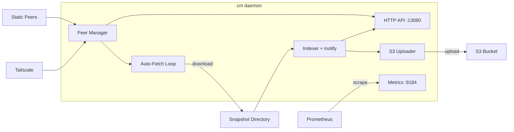

# cm

[](https://github.com/mindrunner/cm-rs/actions/workflows/ci.yml)
[](LICENSE)

A decentralized Solana snapshot cluster manager. `cm` indexes local `.tar.zst`
snapshot files, exposes them over HTTP, discovers and polls peers (static list
and/or Tailscale), downloads newer snapshots from peers with parallel chunked
transfers, optionally uploads to S3, and exports Prometheus metrics.

## Architecture



## Installation

### From source

```bash
cargo install --git https://github.com/mindrunner/cm-rs
```

Requires Rust 1.91+ (edition 2024).

### Pre-built binaries

Download from [GitHub Releases](https://github.com/mindrunner/cm-rs/releases).
Binaries are available for `x86_64-unknown-linux-gnu` and
`aarch64-unknown-linux-gnu`.

### Docker

```bash
docker pull ghcr.io/mindrunner/cm-rs:latest
docker run --rm -v /etc/cm:/etc/cm -v /mnt/snapshots:/mnt/snapshots \
  ghcr.io/mindrunner/cm-rs:latest daemon --config /etc/cm/config.toml
```

Or build locally:

```bash
docker build -t cm .
```

## Quick Start

Create a minimal config at `/etc/cm/config.toml`:

```toml
[node]
snapshot_dir = "/mnt/snapshots"

[peers.static]
hosts = ["peer1:13080", "peer2:13080"]
```

Run the daemon:

```bash
cm daemon --config /etc/cm/config.toml
```

## CLI Reference

```
cm <COMMAND>
```

| Command   | Description                                                | Key Flags                                    |
|-----------|------------------------------------------------------------|----------------------------------------------|
| `daemon`  | Run the full service (indexer, peers, API, metrics, fetch) | `-c, --config <PATH>` (default `/etc/cm/config.toml`) |
| `fetch`   | One-shot: discover peers, download best snapshot, exit     | `-c, --config <PATH>`, `--force` (bypass `min_slots_behind` gate) |
| `status`  | Query a running daemon and print snapshot/peer info        | `-u, --url <URL>` (default `http://localhost:13080`)   |
| `peers`   | List known peers with latency/bandwidth stats              | `-u, --url <URL>`                            |
| `upload`  | One-shot: upload best snapshot to S3                       | `-c, --config <PATH>`                        |

Logging is controlled via `RUST_LOG` (default: `cm=info`).

## Configuration Reference

Configuration is a TOML file. See [`examples/config.toml`](examples/config.toml)
for a fully commented example.

### `[node]`

| Key            | Type   | Default          | Description                          |
|----------------|--------|------------------|--------------------------------------|
| `snapshot_dir` | path   | **required**     | Directory containing `.tar.zst` snapshots |
| `listen_addr`  | string | `0.0.0.0:13080`  | API server bind address              |
| `metrics_addr` | string | `0.0.0.0:9184`   | Prometheus metrics bind address      |
| `cluster_name` | string | none             | Label added to all metrics           |

### `[peers]`

| Key             | Type     | Default | Description                       |
|-----------------|----------|---------|-----------------------------------|
| `poll_interval` | duration | `15s`   | How often to poll peers           |
| `dc_affinity`   | string[] | `[]`    | Prefer peers in these datacenters |

### `[peers.static]`

| Key    | Type       | Default | Description                     |
|--------|------------|---------|---------------------------------|
| `hosts`| string[]   | `[]`    | List of `host:port` peer addresses |

### `[peers.tailscale]`

| Key       | Type   | Default | Description                          |
|-----------|--------|---------|--------------------------------------|
| `enabled` | bool   | `false` | Enable Tailscale peer discovery      |
| `tag`     | string | none    | Tailscale ACL tag to filter by       |
| `port`    | u16    | `13080` | Port peers listen on                 |

### `[download]`

| Key                      | Type     | Default   | Description                                    |
|--------------------------|----------|-----------|------------------------------------------------|
| `backend`                | string   | `builtin` | Download backend: `builtin` or `aria2c`        |
| `parallel_chunks`        | u16      | `16`      | Number of parallel download chunks             |
| `min_slots_behind`       | u64      | `2500`    | Gate for **full** downloads: fetch a full only when the local bootstrap slot is at least this far behind the best peer (or on bootstrap), and only when it improves the bootstrap by at least this much. Incremental top-ups on the local full are not gated. |
| `max_full_snapshots`     | u32      | `2`       | Max full snapshots to retain                   |
| `max_incremental_snapshots` | u32   | `4`       | Max incremental snapshots to retain            |
| `min_speed`              | u64      | `0`       | Min bytes/sec; abort after 60s below and skip that peer this cycle. Not enforced on the last candidate peer. A 60s stall always aborts |

### `[download.aria2c]`

| Key          | Type     | Default            | Description                  |
|--------------|----------|--------------------|------------------------------|
| `binary`     | string   | `/usr/bin/aria2c`  | Path to aria2c binary        |
| `extra_args` | string[] | `[]`               | Additional aria2c arguments  |

### `[s3]`

| Key               | Type     | Default | Description                        |
|-------------------|----------|---------|------------------------------------|
| `enabled`         | bool     | `false` | Enable S3 uploads                  |
| `bucket`          | string   | `""`    | S3 bucket name                     |
| `region`          | string   | none    | AWS region                         |
| `endpoint`        | string   | none    | Custom S3 endpoint URL             |
| `prefix`          | string   | `""`    | Key prefix for uploaded objects    |
| `path_style`      | bool     | `false` | Use path-style bucket addressing   |
| `upload_interval` | duration | `5m`    | How often to check for new uploads |

### `[auto]`

| Key              | Type     | Default | Description                       |
|------------------|----------|---------|-----------------------------------|
| `enabled`        | bool     | `true`  | Enable periodic auto-fetch        |
| `check_interval` | duration | `30s`   | How often to check for new snapshots |

Duration values accept human-readable strings: `30s`, `5m`, `1h`, etc.

## Deployment

### systemd

A service file is included at [`cm.service`](cm.service):

```bash
sudo cp cm.service /etc/systemd/system/
sudo systemctl daemon-reload
sudo systemctl enable --now cm
```

The service runs `cm fetch` before starting the daemon to ensure an initial
snapshot is available. A failed fetch does not block the daemon.

`cm fetch` exits non-zero when no usable local snapshot exists, or when the
local bootstrap is at least `min_slots_behind` behind the best peer, and no
download landed. A failed incremental top-up within tolerance exits 0. Gate a
validator start on it so the validator never boots from a stale snapshot.

### Docker Compose

```yaml
services:
  cm:
    image: ghcr.io/mindrunner/cm-rs:latest
    volumes:
      - ./config.toml:/etc/cm/config.toml:ro
      - /mnt/snapshots:/mnt/snapshots
    ports:
      - "13080:13080"
      - "9184:9184"
```

## API Endpoints

All endpoints are served on the address configured by `node.listen_addr`
(default `:13080`).

| Method | Path                            | Description                                  |
|--------|---------------------------------|----------------------------------------------|
| GET    | `/api/v1/snapshots`             | List all local snapshots (JSON array)        |
| GET    | `/api/v1/snapshot/{filename}`   | Download a snapshot file (supports `Range`)  |
| GET    | `/api/v1/peers`                 | List known peers with stats                  |
| GET    | `/api/v1/status`                | Daemon status (snapshots, highest slot, peer count) |
| GET    | `/v1/best_snapshots?max=N`      | Blockdaemon-compatible snapshot listing      |

Metrics are served on a separate port (`node.metrics_addr`, default `:9184`):

| Method | Path       | Description                    |
|--------|------------|--------------------------------|
| GET    | `/metrics` | Prometheus text format metrics |

## Metrics

All metrics are prefixed with `cm_`. If `cluster_name` is set, a `cluster`
label is added to every metric.

| Metric                            | Type      | Description                    |
|-----------------------------------|-----------|--------------------------------|
| `cm_local_snapshot_slot`          | gauge     | Highest local snapshot slot    |
| `cm_snapshots_local_total`        | gauge     | Number of local snapshots      |
| `cm_peer_latency_seconds`         | histogram | Peer poll RTT                  |
| `cm_peer_download_bytes_per_second` | histogram | Peer download bandwidth      |
| `cm_peer_errors_total`            | counter   | Peer error count               |
| `cm_peers_total`                  | gauge     | Number of known peers          |
| `cm_download_duration_seconds`    | histogram | Snapshot download duration     |
| `cm_download_bytes_total`         | counter   | Total bytes downloaded         |
| `cm_s3_upload_duration_seconds`   | histogram | S3 upload duration             |

## Acknowledgments

`cm` was inspired by [Blockdaemon's solana-cluster](https://github.com/Blockdaemon/solana-cluster),
a Go-based tool for managing Solana snapshots across private clusters. If you're
looking for an alternative with a different architecture (centralized tracker +
sidecar model), check it out.

## Contributing

See [CONTRIBUTING.md](CONTRIBUTING.md).

## License

Licensed under the Apache License, Version 2.0. See [LICENSE](LICENSE) for
details.
